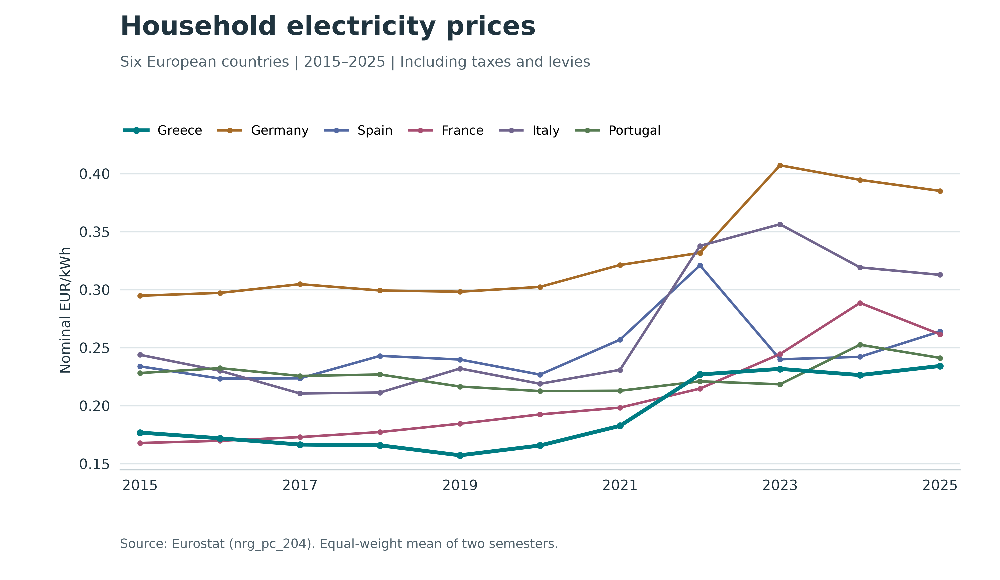
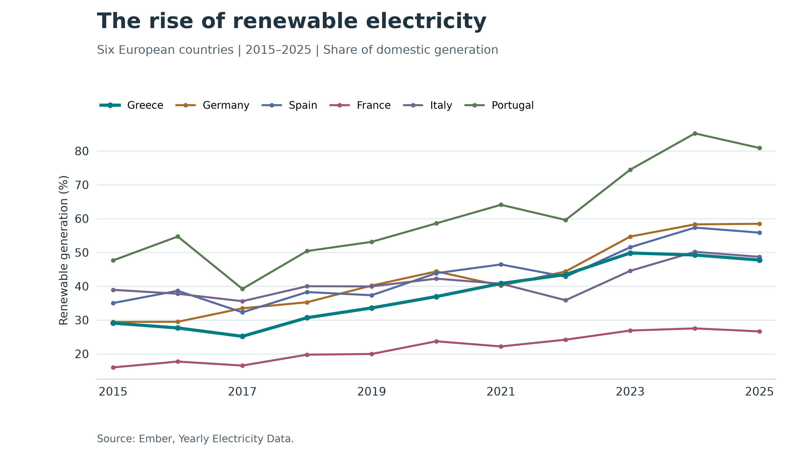
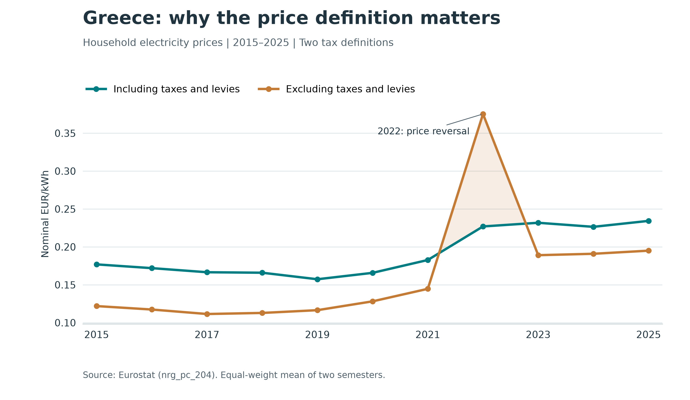

# Household electricity prices and renewable generation in Europe

A Python analysis of household electricity prices and renewable electricity generation in Greece, Germany, Spain, France, Italy and Portugal (2015–2025).

## Data

- [Eurostat (nrg_pc_204)](https://ec.europa.eu/eurostat/databrowser/view/nrg_pc_204/default/table?lang=en): nominal EUR/kWh, household consumption band DC (2,500–4,999 kWh/year), including and excluding all taxes and levies.
- [Ember – Yearly Electricity Data](https://ember-energy.org/data/yearly-electricity-data/): renewable share of domestic electricity generation (%), using the reported renewables aggregate. Ember data are licensed CC BY 4.0.

## Run

```bash
python -m pip install -r requirements.txt
python -m unittest discover -s tests -v
python analysis.py
```

Source files are downloaded to `data/` and reused on subsequent runs. Use `--refresh` to update them or `--offline` to use only existing files. Retrieval dates, URLs and SHA-256 checksums are stored alongside the downloads.

## Method

- Harmonise country codes using ISO3 identifiers (including EL → GRC).
- Average the two semester prices with equal weights; leave the annual value missing if either semester is unavailable.
- Check for duplicates, missing values, source quality flags and invalid renewable shares.
- Compare 2015–2025 trends and calculate descriptive Pearson correlations between consecutive annual changes in prices and renewable shares.

## Results

Data retrieved on 25 November 2026 cover all 66 country-years. Renewable generation shares and nominal tax-inclusive household prices increased in all six countries between 2015 and 2025.





Portugal recorded the largest increase in renewable share (+33.25 percentage points) and the smallest increase in nominal household prices (+0.013 EUR/kWh). Greece's renewable share increased from 29.09% to 47.75%, while household prices rose from 0.177 to 0.234 EUR/kWh.

### Why price definitions matter



In Greece in 2022, the tax-inclusive annual price was 0.227 EUR/kWh, compared with 0.375 EUR/kWh excluding taxes and levies. A smaller reversal occurred in Portugal in 2023. These observations are retained and listed in `results/negative_tax_gaps.csv` for review. A negative gap can reflect subsidies and allowances rather than a data error or a conventional tax burden, consistent with [Eurostat's energy crisis reporting](https://ec.europa.eu/eurostat/web/products-eurostat-news/w/ddn-20230426-2) and the [European Commission's energy prices report](https://eur-lex.europa.eu/legal-content/EN/TXT/?uri=celex%3A52025DC0072).

One source observation is flagged `d` (definition differs): Spain, 2019 S1, excluding taxes. It is retained and recorded in `results/price_quality_flags.csv`.

## Limitations

Annual prices are simple semester averages rather than consumption-weighted annual estimates. Prices are nominal, not inflation-adjusted. Domestic renewable generation share is not the renewable share of household consumption. Retail prices also depend on wholesale costs, network charges, taxes, subsidies and contracts. Correlations vary across countries and are exploratory (10 paired annual changes per country), not causal estimates.

## Reproducibility

Processed tables, figures and quality-control reports are saved in `results/`. Four automated tests use synthetic fixtures; the initial real-data run on 25 November 2026 completed successfully. Source datasets can be revised, so retain the original downloads and metadata to reproduce this snapshot.
